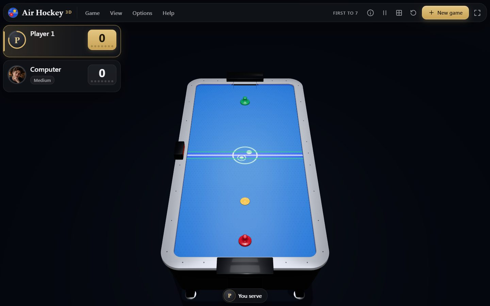
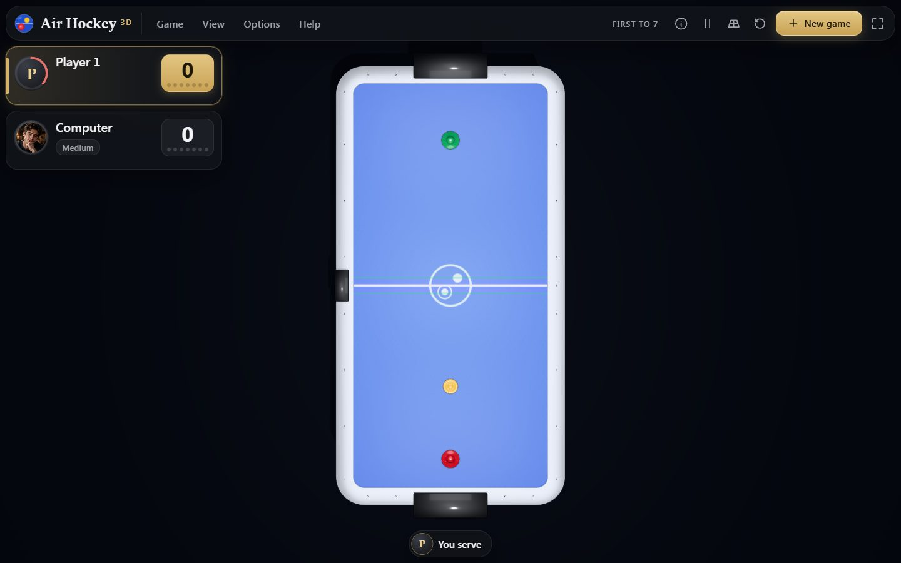
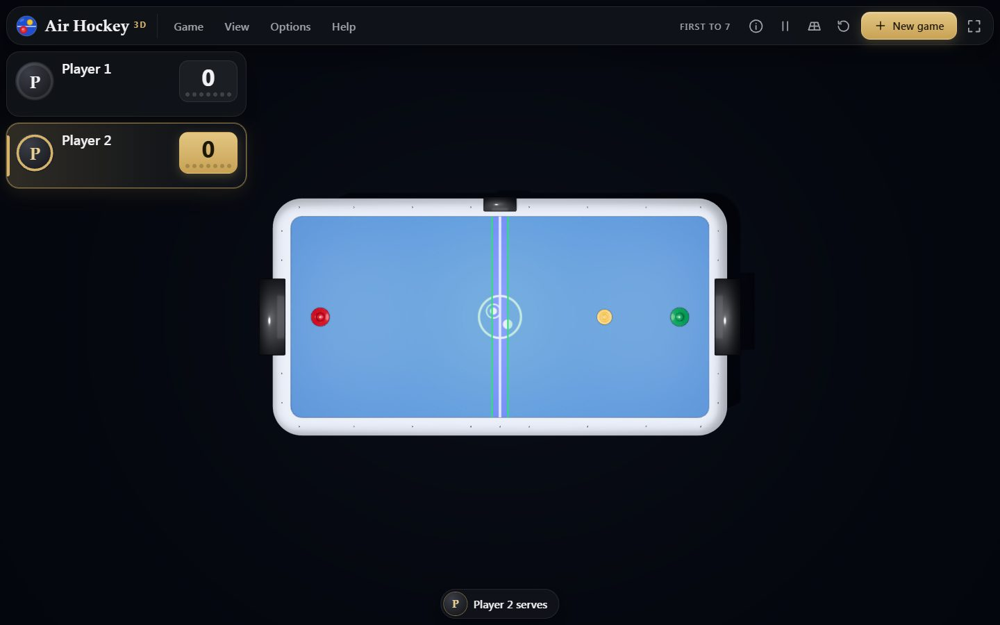

# Air Hockey 3D

A 3D air hockey game for the browser. Play against the computer at three strengths, against a
friend on the same device, or against a friend online with voice and video, on an 8-foot coin-op
table seen in 3D or straight from above.



## What is in it

- **Real-time puck physics.** The puck slides on its air in fixed steps of 1/240 s, bounces off the
  rails, the rounded corners and the goal posts, and takes the momentum of the mallet that strikes
  it. Every contact is found in closed form, so nothing passes through anything at any speed, and
  a puck pinned against a rail never rattles. See [docs/physics.md](docs/physics.md).
- **Mallets moved like hands.** The mouse, a finger or the keys say where a mallet should go. It
  gets there no faster than a hand would, and never out of its zone.
- **Mallet zones.** Each player's mallet stays in their own zone, shown in green: the whole half
  to the centre line, or two fifths, a third or a quarter of the table, the same for both players
  (online, the host's choice). A puck stranded where neither mallet may go can be fetched, as at a
  real table. See [docs/rules.md](docs/rules.md).
- **A computer opponent** at three strengths, each a person with a portrait. It sees the puck
  late, moves with a hand's limits, predicts the bounces, and banks its shots. See
  [docs/ai.md](docs/ai.md).
- **A table built in Blender** from the same description as the physics, so the rails you see are
  the rails the puck hits. It has a silver or black finish, a surface lit from within, and the
  live score on the table's own display. See [docs/table.md](docs/table.md) and
  [docs/visual-research.md](docs/visual-research.md).
- **Online with a friend.** Send a link or show a QR code. Voice and video show in the players'
  cards, and either player can hang up while the match goes on. There is no server: the two
  browsers meet through public Nostr relays, then talk directly over WebRTC.
  - **No delay on your own hits.** The puck is played on the device of the player whose half it is
    in, so your own hits are never late, and it is passed over at the centre line.
  - **Each side checks the other**, and a player whose app breaks the rules loses the match.
  - See [docs/protocol.md](docs/protocol.md).
- **Recorded sounds** for the mallets, the rails, the posts and the goal, chosen by what happened
  and how hard. See [docs/sounds.md](docs/sounds.md).

| Top view | Two players on one device |
|---|---|
|  |  |

## Playing

**Starting a match.** Choose **Against the computer**, **Two players**, **Play a friend online**,
or **Join a game** to open a link you were sent. The New Game sheet also sets:
- the computer's strength, from its portraits
- the goals to win
- the mallet zone
- who serves first

On a tablet or a computer the menu bar along the top (Game, View, Options, Help) holds all of these,
the view and the settings; on a phone they are behind the menu button.

**Your mallet** follows the mouse over the table, or a finger dragged on it, within its green
zone. W A S D move it too. With two players on one device, each finger drives the mallet of the
half it touches, and the second player has the arrow keys.

**The game:**
- **Serving.** The puck is served from the middle of the server's half. The player scored on
  serves next.
- **The seven-second rule.** A player may keep the puck in their half for seven seconds; the ring
  round their card counts them down.
- **Pausing.** Escape pauses a match on one device; online, it opens the menu while play goes on.

**The camera** turns, tilts, zooms and pans:
- right-drag to turn and tilt
- the wheel to zoom
- the arrow keys (with one player)
- Home resets it
- F looks from the other end
- T switches to the top view, which faces you from your own end

Every key and gesture is listed in the game under **Keyboard and mouse** (or press `?`). The (i)
button shows what each part of the screen does.

## Running it

```
npm ci
npm run dev          # the development server
npm run build        # type-check and build the site into dist/
npm test             # unit and architecture tests
npm run lint
npm run format:check
npm run audit:dist   # no secrets, private data or forbidden names in the built site
```

End-to-end tests drive real browsers against the production build. Run them **one file at a time**,
for example `npx playwright test tests/e2e/game.spec.ts`. `tests/e2e/online.spec.ts` needs the
internet: two browser windows meet over the public relays, with Chromium's test camera and
microphone.

The table, the mallet and the puck are built with Blender 5.2 by `npm run models`, from the
geometry that `node scripts/export-table.ts` writes.

## Deploying

`.github/workflows/deploy.yml` publishes the site to GitHub Pages on every push to `main`, after
the lint, the tests, an audit of the whole history and of the built site, and the build. The site
is static: no server is needed, online play included.

## Known limits

- **No relay (TURN) server.** Online play connects the two browsers directly, and about one pair of
  networks in ten cannot connect.
- **A cheating defender.** It could report the puck a little off within what is physically
  possible on its own half. The checks catch teleports, impossible speeds, walls passed through
  and courses changed from nowhere, but not every subtle lie (see
  [docs/protocol.md](docs/protocol.md)).
- **Figures beyond the reference.** The table's dimensions beyond the cabinet and the puck are
  measured off the reference's photographs and tuned in play, not taken from an official
  rulebook.
- **The puck never leaves the table.** It stays on the surface and never jumps a rail.
- **The sounds** are Pool's billiard recordings, chosen to sound close; none was recorded at an air
  hockey table.
- **Tested in Chromium.** The game was tested in Chromium on a desktop, in software rendering; no
  real phone has been measured. A device that animates at under 40 frames a second lowers its
  graphics by itself.

## Licence

GPL-3.0-or-later (see [LICENSE](LICENSE)). The recorded hits are under the Pixabay Content License,
and the computer's portraits are the author's own art from Grandmaster 3D. Every third-party part
and its licence is listed in [NOTICE.md](NOTICE.md).
